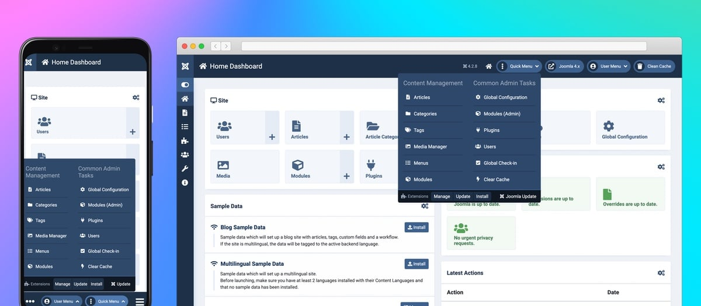
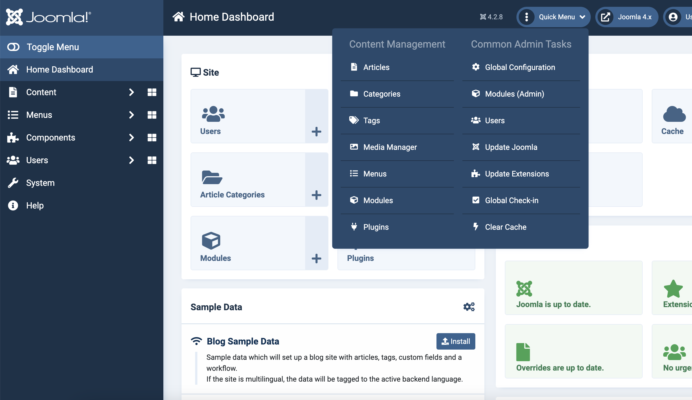
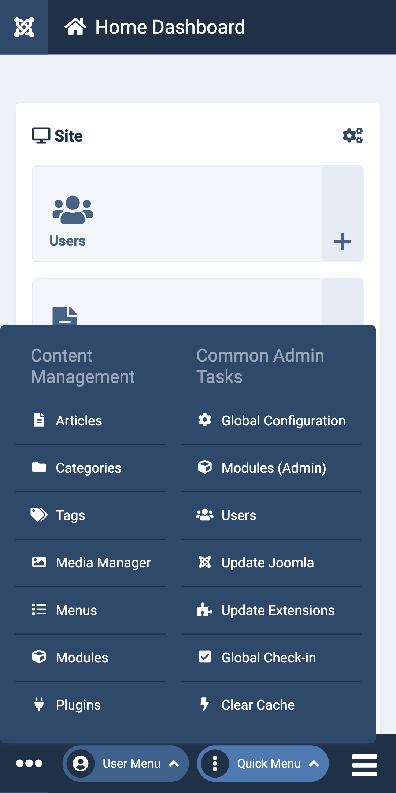

  <picture>
    <source media="(prefers-color-scheme: dark)" srcset="/media/mod_jw_quickmenu/logo/quickmenu-logo-dark.svg">
    <source media="(prefers-color-scheme: light)" srcset="/media/mod_jw_quickmenu/logo/quickmenu-logo-light.svg">
    
  </picture>

Quick Menu
=========

Quick Menu is a Joomla 4, 5 & 6 administrator module which adds a handy quick menu to the Joomla backend to restore UX sanity!

## FEATURES
- Less clicks to important content management and admin tasks in the Joomla backend... duh!
- Neatly organize the menu in 2 columns (for admins), one to access common content management tasks and one to access common admin tasks. Keep in mind that not everything is included and for good reason: keep things simple.
- Respects configured backend access permissions for your user groups. In other words, plain content managers will see menu options for what they can only access, whereas Super Admins will see menu options for everything.

## HOW TO USE
- Install the module.
- After installation, locate the module in Administrator Modules and click to edit it. Or click the handy direct link to Administrator Modules from the module installation message.
- Assign the "status" module position & publish.
- Done!

Updating is easy as future releases will show up in the extension updates page in Joomla.

## PREVIEWS
| On desktop    | On mobile     |
| ------------- | ------------- |
|  |  |

## COMPATIBILITY
Quick Menu is compatible with Joomla versions 4.x, 5.x, and 6.x on servers running PHP 8.x (and PHP 7.4+ on Joomla 4).

## LICENSE
Quick Menu is a Joomla module developed by JoomlaWorks, released under the GNU General Public License.

## DOWNLOAD
To download the latest stable version of the extension, please visit the Quick Menu product page at: [https://www.joomlaworks.net/extensions/free/quickmenu](https://www.joomlaworks.net/extensions/free/quickmenu)

---

Last update: November 20th, 2026 - Version 2.0
